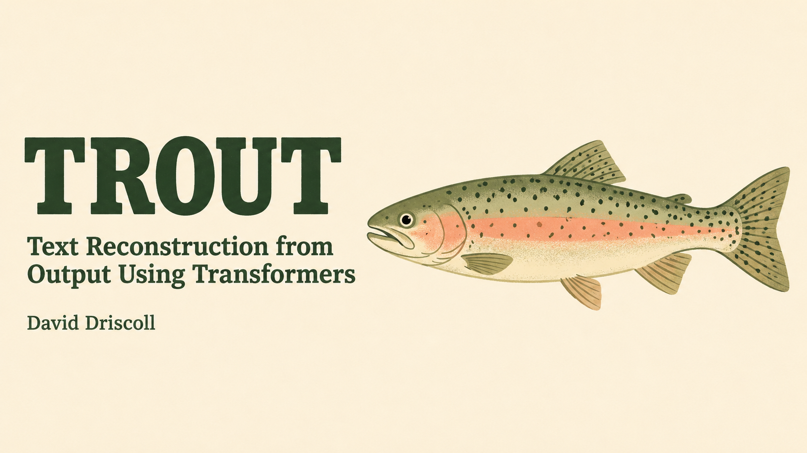

# TROUT



Text Reconstruction from Output Using Transformers.

Given one assistant answer, generate a prompt with the same meaning as the first user prompt. This is a standalone Apple silicon experiment by David Driscoll. The model sees the response text alone. Several prompts can produce the same answer, so a plausible reconstruction may still miss the target.

## Model and data

The base is [Qwen2.5-0.5B-Instruct](https://huggingface.co/Qwen/Qwen2.5-0.5B-Instruct). MLX-LM trains rank-8 LoRA adapters on the query and value projections in the final eight layers, with the input masked out of the loss. Corpus and base revisions are pinned in settings.py.

Training uses 25,000 first-turn pairs from [UltraChat 200k](https://huggingface.co/datasets/HuggingFaceH4/ultrachat_200k), with 500 validation and 500 held-out test pairs. We preserve the recorded prompt text, cap the entire example at 768 tokens, group by normalized prompt template and drop repeated normalized answers. Paraphrases can still cross splits. The test measures reconstruction on short synthetic dialogues.

## Semantic training and results

After supervised training, we sample two candidate prompts per response for 1,024 training examples. A frozen [MiniLM sentence encoder](https://huggingface.co/sentence-transformers/all-MiniLM-L6-v2) compares each candidate with the recorded user prompt. We continue training the adapter on the better candidate when its cosine similarity is at least 0.70 and its lead over the other candidate is at least 0.05. These are training selection thresholds. Cosine similarity is a continuous score and cannot establish that every fact or constraint was recovered.

<!-- held-out-results -->

The 500-response held-out comparison is pending.

<!-- end-held-out-results -->

### Early validation measurement

The table below compares the step-300 supervised checkpoint and the untuned base on the first 12 validation responses using the original wording-recovery instruction. Both decoded greedily. Semantic refinement had not started. The interval spans zero, and this pilot is separate from the 500-response test. The final comparison uses the same meaning-focused instruction for all three models and includes the supervised adapter before refinement.

| Model | Responses | Mean prompt cosine ↑ | Verbatim matches | Mean edit distance ↓ |
|---|---:|---:|---:|---:|
| Untuned Qwen | 12 | 0.591 | 0 | 0.785 |
| LoRA adapter | 12 | 0.640 | 0 | 0.763 |

Mean paired cosine gain: +0.049. 95% bootstrap interval across responses: [-0.133, +0.208].

## Reproduce on Apple silicon

Use Python 3.11 in a virtual environment.

```sh
pip install -r requirements.txt
python download.py
python prepare.py
python -m mlx_lm lora --config train.yaml --model .assets/base --data data --adapter-path adapters
python evaluate.py
printf '%s' 'The capital of France is Paris.' | python predict.py --adapter adapters/semantic
```

Evaluation compares the untuned base and adapter using the same 500 responses and greedy decoding with a 256-token output limit. The primary metric is the mean cosine between the generated prompt and the original prompt, encoded with MiniLM's 256-token limit. The two models use the same generation instructions. We also report exact match counts, normalized character edit distance, and a paired bootstrap interval for the cosine gain. Running evaluate.py first trains the semantic refinement, then writes results to adapters/semantic/evaluation.json. The native MLX adapter requires MLX-LM.

## Credits

This experiment adapts Qwen on UltraChat for local prompt reconstruction. Earlier research directly investigated inferring prompts from model outputs, including [Output2Prompt](https://aclanthology.org/2024.emnlp-main.819/). Qwen weights are Apache-2.0 licensed and the UltraChat 200k dataset card lists MIT. Dataset examples and base weights are downloaded separately.
